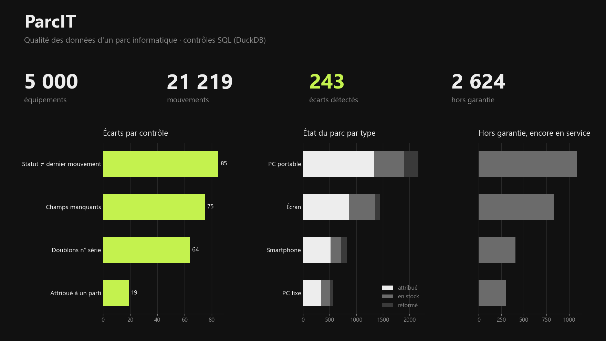

# ParcIT · Qualité des données d'un parc informatique

Projet personnel : fiabiliser la base d'un parc informatique (5 000 équipements, 2 200 collaborateurs,
21 000 mouvements) et produire le reporting pour les équipes et le management.

> Les données sont **fictives**, générées par `generate_data.py`, avec des anomalies injectées
> volontairement pour tester les contrôles.



## Contenu

| Fichier | Rôle |
|---|---|
| `generate_data.py` | génère `data/equipements.csv`, `utilisateurs.csv`, `mouvements.csv` (attributions, restitutions, mises au rebut) |
| `sql/controles.sql` | contrôles de cohérence (DuckDB) + synthèse + parc à renouveler |
| `data/export_*.csv` | résultats des contrôles, source du dashboard Power BI |
| `apercu.py` | aperçu du reporting (`docs/apercu.png`) en attendant le dashboard |

## Contrôles

1. Numéros de série en doublon
2. Matériel encore attribué à un collaborateur parti
3. Statut en base différent du dernier mouvement enregistré
4. Champs obligatoires manquants (garantie, utilisateur d'un matériel attribué)
5. Synthèse des écarts pour le manager
6. Parc hors garantie à renouveler

## Lancer

```bash
pip install duckdb
python generate_data.py
python -c "import duckdb; c = duckdb.connect('parcit.duckdb'); c.execute(open('sql/controles.sql', encoding='utf-8').read()); print(c.sql('select * from synthese_controles'))"
```

## En cours

Dashboard Power BI : état du parc par site et par type, mouvements du mois, écarts à traiter, renouvellements.
